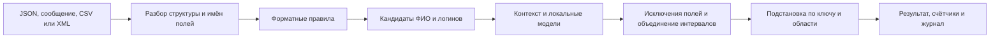

# Как работает обработка

Правила формата ищут email, телефоны, карты, документы, токены и другие поддерживаемые типы. Для CSV правила выбираются по заголовку, для XML по тегам и атрибутам. JSON может содержать экранированный JSON внутри строк. Детектор восстанавливает смещения найденного значения в исходном тексте.

В `message` и `event.original` обычный текст сохраняется. Для ФИО проверяются кандидаты из двух или трёх слов, двойные фамилии и инициалы. Русские ФИО могут быть записаны кириллицей, транслитерацией и смешанными буквами. Форма фамилии оценивается небольшим символьным классификатором. Дополнительная модель прозы применяется по явному выбору хоста.

Личные логины сравниваются с ближайшим контекстом учётной записи. Явные признаки служебной записи помогают сохранить технические значения. Отдельные контекстные модели чисел и токенов можно загрузить в теневом режиме для наблюдений. Их предложения сохраняются в счётчиках.

Для типизированного вывода HMAC определяет подстановку букв и цифр. Разделители сохраняются. В самом результате подстановки хэш отсутствует. Строгий маркер содержит непрозрачный псевдоним. Подстановка детерминирована при одинаковых ключе, области, типе и значении.

`stream-log` читает поток окнами с перекрытием. Недавние подтверждённые имена сохраняются в ограниченном кеше на время одного потока. Журнал подстановок хранится у вызывающего приложения. При ошибке записи или чтения ранее записанная часть потока может остаться в целевом файле. Приложение отвечает за завершение или отмену такой операции.

Граница SDK `SanitizeJson` и режимы просмотра имеют разный контракт. Подробности — в [contract.md](contract.md). Пример использования всех основных форматов — в [Quickstart](../examples/Quickstart/Program.cs).
